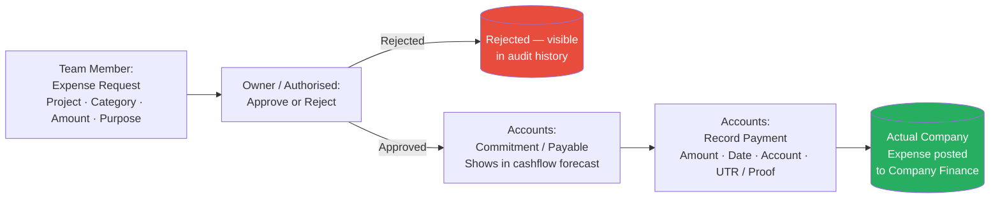
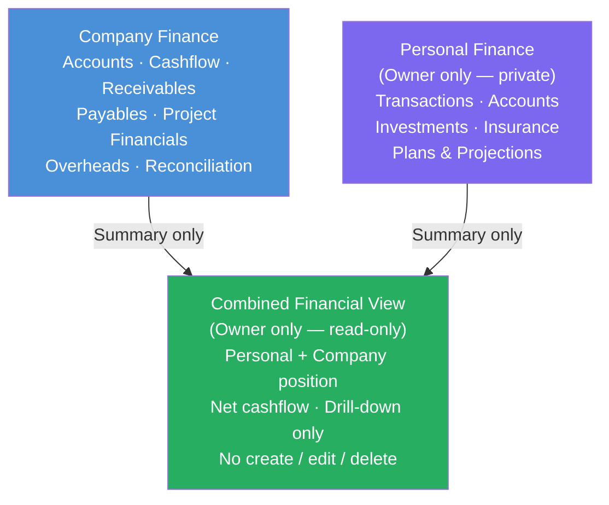

# SpaceKrafters OS — End-to-End Operating Flow

## Primary Lead-to-Closure Flow

```mermaid
flowchart TD
    A([Lead Enquiry\nWalk-in · Referral · Online · WhatsApp])
    A --> B

    B["Project Coordinator / Owner:\nCapture Lead\nSource · Client · Contact · Assign"]
    B --> C

    C["Project Coordinator:\nSchedule Appointment\n& Follow-ups · SLA tracking"]
    C -->|No response / Lost| LOST([Lead Lost ✗])
    C -->|Appointment confirmed| D

    D["Site Engineer:\nSite Visit\nMeasurements · Room-wise Requirements\nPhotos · Checklists"]
    D --> E

    E["Project Coordinator / QS:\nRequirements & BOQ Inputs\nConvert site data → specifications"]
    E --> F

    F["QS / Project Coordinator:\nProposal / BOQ / Quotation\nLine items · Rates · Taxes · Terms\nInternal cost plan (separate)"]
    F --> G

    G["Owner:\nInternal Approval\nQuotation review before client send"]
    G -->|Rejected — rework| F
    G -->|Approved| H

    H["Designer / Architect:\nDesign Package\nMoodboards · Drawings · Revisions\nClient approval or revision request"]
    H -->|Revision requested| H
    H -->|Design approved| I

    I["Project Coordinator:\nSend Quotation + Design to Client\nEmail with sent history"]
    I --> J{Client Decision}

    J -->|Lost / No response| LOST
    J -->|Negotiating| I
    J -->|Client Approved| K

    K["Project Coordinator / Accounts:\nCollect Advance Payment\n1st Milestone · Post to Company Finance"]
    K --> L

    L["Project Coordinator:\nCreate Project\nWorkspace: Overview · Timeline · Team\nRequirements · Design · Payments"]
    L --> M

    M["Project Coordinator:\nWork Breakdown Structure\nStages → Tasks → Subtasks\nOwners · Deadlines · Dependencies · Gantt"]
    M --> N

    N["Purchase:\nProcurement\nRequirement → Purchase Request\n→ Vendor Quotes → Comparison → Approval\n→ PO → Material Received → Vendor Bill"]
    N --> N1

    N1{Material\nAvailable?}
    N1 -->|Awaiting material| N2["Purchase:\nFollow up Vendor\nUpdate payable status"]
    N2 --> N1
    N1 -->|Received| O

    O["Site Engineer:\nOn-site Execution\nTasks · Daily Diary\nProgress Notes · Photos · Evidence"]
    O --> O1{Task complete?}
    O1 -->|Late / blocked| O2["Site Engineer:\nMandatory late reason\nEscalate to Coordinator + Owner"]
    O2 --> O1
    O1 -->|Complete| P

    P["Accounts / Project Coordinator:\nMid-project Payment Milestones\nInvoice → Collection → Post to Company Finance"]
    P --> Q

    Q["QS / Project Coordinator:\nHandover Preparation\nPunch list · Snag fixes · Documents\nClient sign-off"]
    Q --> R

    R["Project Coordinator / Accounts:\nFinal Payment Collection\nFull payment confirmed\nPost to Company Finance"]
    R --> S

    S["Accounts:\nFinancial Reconciliation\nProject actual vs budget\nReceivables settled · Payables cleared"]
    S --> T

    T([Project Closed ✓\nHandover complete · Full paid\nAudit trail locked])

    style A fill:#4A90D9,color:#fff
    style LOST fill:#E74C3C,color:#fff
    style T fill:#27AE60,color:#fff
    style G fill:#7B68EE,color:#fff
    style O2 fill:#F39C12,color:#fff
    style N2 fill:#F39C12,color:#fff
```

---

## Expense & Procurement Lifecycle (parallel flow)

---

## Finance Architecture (owner view)

---

## Stage Summary

| # | Stage | Role | Key Output |
|---|---|---|---|
| 1 | Lead capture & follow-up | Project Coordinator | Lead record, SLA tracking |
| 2 | Appointment | Project Coordinator | Confirmed meeting |
| 3 | Site visit | Site Engineer | Measurements, photos, room requirements |
| 4 | Requirements & BOQ inputs | QS / Project Coordinator | Specifications |
| 5 | Proposal / Quotation | QS / Project Coordinator | Client-facing BOQ + internal cost plan |
| 6 | Internal approval | Owner | Approved quotation |
| 7 | Design package | Designer / Architect | Drawings, moodboards, client approval |
| 8 | Send to client | Project Coordinator | Quotation + design emailed |
| 9 | Client approval | — | Signed/confirmed approval |
| 10 | Advance payment | Accounts | 1st milestone collected, posted to finance |
| 11 | Project creation | Project Coordinator | Workspace, WBS, Gantt, team assigned |
| 12 | Procurement | Purchase | PO, material received, vendor bill → payable |
| 13 | On-site execution | Site Engineer | Tasks completed, daily diary, evidence |
| 14 | Mid-project collections | Accounts | Milestone invoices collected |
| 15 | Handover preparation | Project Coordinator / QS | Punch list cleared, client sign-off |
| 16 | Final payment | Accounts | Balance collected, posted to finance |
| 17 | Financial reconciliation | Accounts | Actuals vs budget, payables cleared |
| 18 | Project closure | Owner / Accounts | Closed, immutable, audit locked |

---

## Key Differences vs Fenster Flow

| Aspect | Fenster | SpaceKrafters |
|---|---|---|
| Business type | Window / door manufacturing + install | Interior design & construction |
| Design stage | None | Full design center with revisions |
| Procurement | Simple material check | Full PR → Quote → PO → GRN → Bill flow |
| Finance | Basic payment tracking | Full Company Finance + Personal Finance + Combined View |
| Task management | Linear flow stages | True WBS: Project → Stage → Task → Subtask + Gantt |
| Roles | Lead Manager, SE, Production, Technician | Coordinator, SE, Designer, QS, Purchase, Accounts, Owner |
| Expense lifecycle | Not present | Request → Approve → Commitment → Payment → Actual |
| Quotation | Single quotation to owner then client | Internal approval + versioned BOQ + design package |
| Handover | Completion confirmation | Formal punch list, snag fixing, client sign-off, financial reconciliation |
